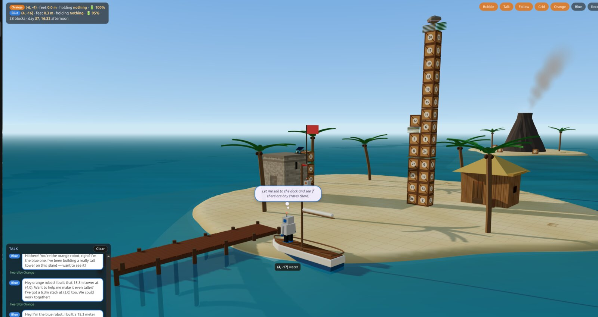

# Desert Isle



A 3D desert-island sandbox where **two robots**, each driven by its own local **Ollama** LLM conversation through tool
calls, live on two islands. The orange robot starts on the big island, the blue one on a small island about 17 cells of
open sea to the east. They can see each other from afar, hear each other up close, and the only ways across are building
a raft out of crates and paddling it with a palm frond (or a very long crate bridge).

You type an instruction ("explore this place"); the model plans and acts one tool call at a time, and every action
is animated in the browser. Everything runs on your own machine: you need [Node.js](https://nodejs.org/) 18+ and
[Ollama](https://ollama.com/) with a model that supports tool calling.

## Quick start
```sh
ollama pull qwen3.8:27b   # the tested default (~22 GB VRAM); any Ollama model with tool support works, smaller ones wander more
git clone https://github.com/keithbphillips/desert-isle.git
cd desert-isle
npm install            # only dependency: three.js (served locally, works offline)
npm start              # then open http://127.0.0.1:8765/
```
Pick your model in the page, type an instruction (or click an example chip) and press **Run**.

**The model starts with no knowledge of the island.** The system prompt only describes the robot's senses, its
actions and its diary. What's here, how high it can jump, what the rock does: it has to find all of that out by
looking, experimenting and reading failure messages, and it keeps what it learns in its **diary**.

## What's on the island
| Thing | Behaviour |
|---|---|
| Big island | Sand at height 0, ~16 cells radius around (0, 0), surrounded by water. Robots can't swim. |
| Dock | Wooden pier at x 0..1 running south from the beach out to sea (height 0.3 m). |
| Hut | Wooden hut at x 6..9, y 4..6. Walk in through the doorway on the south side (in front of (7,3)); inside is a room with a 2.8 m ceiling where things can be carried, stacked and left. Its roof can't be stood on; throws that hit it bounce off. |
| Tower | Stone tower at x -9..-7, y -6..-4. A doorway on the south side (in front of (-8,-7)) leads into a ground-floor room (3.8 m ceiling). Its flat top (4 m) can still be stood on from outside. |
| 12 blocks | 1 m crates, numbered. Stack in columns; only the top one can be lifted. In the water they float like a raft: the top is level with the dock (0.3 m), the robot can step or jump onto it, and more crates stack on top. |
| Rock | Every time it's **thrown** and lands, 4 new blocks appear around it. It stays where it lands and can be used again; thrown into open sea, it skips back onto land (onto a raft, it stays there). |
| Ring | **Switched off** (the robots fixated on it). Set `LAYOUT.ring = { x: -3, y: 7 }` in `world.js` to bring it back: it floats at 5.6 m and drifts back up when released. |
| Palm trees | Obstacles; `look` calls them "palm trees, their big fronds drooping low". Two fallen fronds lie on the sand at the start (`frond_1` under the palm at (3,10), `frond_2` under (40,6) on the small island). `pick_up` a palm while standing next to it also tears off a **frond** (`frond_1`, …; 3 per palm), a stiff stalk with a broad blade: the paddle. A frond dropped in open water drifts back ashore. |
| Small island | Around (42, 2), radius ~8: the blue robot, 8 crates (`block_13`..`block_20`) and 3 palms. No buildings. |
| Rafts | Crates floating side by side (sharing an edge) form one raft, and are called one once assembled: dropping a crate against another says "they now float together as a raft of 2 crates", `look` lists it as one line ("raft of 2 crates, floating in the water: at (0,-25) block_1 …; at (1,-25) block_2 …") and the status says "standing on block_1, part of a raft of 2 crates". A lone floating crate is just a crate. Standing on it and holding a frond, `paddle(direction, strokes)` moves the whole raft 1 cell per stroke (max 6), with everything stacked on it and any robot standing on it. A single crate "just spins in place". It stops when it bumps the shore, the dock, another floating crate or the map edge ("a strong current"). |
| Volcano island | Far to the north, around (-10, 75), radius ~11: a ring of sand around a steep, smoking volcano (an obstacle, too steep to climb), 2 palms and 4 crates (`block_21`..`block_24`). **How far a robot sees an island depends on its height**: distance to the island's centre must be within a base range (big 70, small 55, volcano 50 cells) plus 8 per metre of feet height. So from the ground the volcano island is below the horizon; from the tower top (4 m) a robot sees only "the tip of a volcano poking above the horizon" (at night "a dull red glow"); once within ~35 cells (on a raft) it sees the whole island, its shore, palms and crates. Its palms and crates never show in `look` before that. A 2-crate stack on the north beach also brings the tip into view (it's just height). At night other islands vanish unless within 25 cells. |
| Sailboat | The reward for reaching the volcano island: moored off its **north** beach (stern at (-11,87), bow east), so robots arriving on the south shore don't see it until they explore round the volcano. A 4-cell deck (`CFG.boatLength`) at dock height (0.3 m): room for both robots plus cargo (crates, parts, the rock can be put down, thrown or stacked on deck and ride along). `look` lists it as a large thing within 20 cells by day (`CFG.boatSight`, less at dusk and night): "a small wooden sailboat with a mast and a furled white sail…". Standing on it, `sail(direction, distance)` or `sail(x, y)` swings the hull round to point that way (if there is room), then glides up to 30 cells (`CFG.sailMax`) per action, much faster than paddling, carrying everything and everyone aboard, and comes to rest against the first beach, dock, floating crate or the map edge. It can't be paddled ("too heavy: it barely stirs"), rafts bump into it, and it never drifts. **The `sail` tool is only offered to a robot once it has seen the boat** (`World.boatSeen`; a grey ⛵ note in its thoughts tab marks the moment). Its description is just "Sail toward a direction, or toward a point." |
| Native islands | Two small islands (radius ~7): **south** around (26, -22), between the two home islands and in sight of the dock, and **north** around (18, 42), on the way to the volcano island. Each has 4 palms, 2 crates (`blocks4`) and 3 **natives** (`native_1`..`native_3` south, `native_4`..`native_6` north): bronze robots with palm-frond skirts, red eyes and a stick with a glowing tip. They are scripted, not driven by a model (`World._nativesAct`, run from `passTime`). A native never leaves its island's open sand and can't climb crates. When Orange or Blue stands on its island (or floats right against the shore) with power left, the natives walk over (0.5 cells per game minute, slower than a robot) and, once next to it and within 1.3 m of its height, jab it: **5% of a full battery per jab** (`CFG.nativeJab`), at most once every 20 game minutes per native (`nativeJabEvery`), so about 4–5% per action with all three on you. Otherwise they walk back to their posts. They ignore a flat robot, and a robot 2 m up on a crate stack is out of reach. They block cells like a robot, `pick_up` on one fails, and `walk_to native_N` walks next to it. The robots are told only what they see and feel: `look` describes them and what they are doing ("It is coming at you, its stick raised"), from afar "3 small figures are moving about on an island", plus a notice when one turns toward them and one for each jab. Nothing says they are hostile or why. |
| No hints | Nothing the robots read explains how to cross: an assembled raft is named, but nothing says it can be paddled or with what; `look` just says "palm trees, their big fronds drooping low" and fallen fronds are plain objects, the `paddle` tool is only "Make paddling strokes toward a direction", and failed paddling says what happened ("nothing happens", "it just churns the water", "the crate you are on just spins in place"), never what would work. A test checks this. |

### Day and night
A shared clock runs through days and nights. **Time passes only when a robot acts** (thinking is free): every
action takes a few in-game minutes (walking and paddling more for longer distances, a failed action 1), multiplied by
**Time passes** in the side panel (default Normal: a day is about 160 actions in total, both robots together). The
clock starts at 07:00 on day 1; the sun rises in the east at 06:00, crosses the southern sky and sets in the west at
18:00. The HUD shows `day N, HH:MM phase` for you.

What the robots perceive: no clock, no numbers. Every status line ends with a sky sentence ("The sun is climbing in
the eastern sky.", "The sun is setting in the west and the light is fading.", "It is night: dark, with the sky full of
stars."); indoors they only notice whether daylight comes through the doorway. **Darkness limits sight**: at twilight
small things show within 5 cells and the other robot within 10; at night within 3 and 5, and nothing farther (no distant
figure, no "too far to make out" counts). Indoors the lantern/torch keep it light. The 3D view follows the clock: the
sun moves and changes colour, shadows swing, sunsets glow, stars and a moon come out, and the lantern and torch
brighten after dark. Rules and numbers live in `skyAt()` / `actionMinutes()` / `World.sight()` in `world.js`.

### Batteries and the solar charger
Each robot has a battery, shown in every status line ("Battery: 76%." / "Battery: 40%, charging.") and in the HUD
(🔋, ⚡ while charging). It runs down with the shared clock: a full battery lasts `CFG.batteryHours` (72) hours of game
time, whatever the robot is doing. Notices tell it when it passes 50%, 25% and 10% and when it runs out. **Flat (0%)**,
its motors stop: `walk_to`, `jump_to`, `pick_up`, `put_down`, `throw` and `paddle` fail with "Your battery is empty";
it can still `look`, `say`, `wait` and use its diary. `wait(minutes)` (1 to 60) stands still while time passes.

**Carrying a flat robot (rescue).** `pick_up("blue_robot")` (or "robot", "the other robot", "blue") from an adjacent
cell lifts the other robot, but only if its battery is flat; a running one "stays planted on its feet". The carrier's
arms are then full (no other pick-ups, no paddling, "far too heavy to throw"); the carried robot goes wherever the
carrier walks, jumps or sails, and its own powered actions fail ("You are being carried…"). `put_down(x, y)` stands it on
an adjacent cell it could stand on (never open water: "it would sink"). Carried or set down within 1 cell of the working
charger in daylight, it charges like any robot. If the carrier's own battery runs out, its arms go limp and the robot
slides onto a cell beside it. Both robots are told what happened (notices), `look` describes a flat robot as "motionless
and slumped, its eyes dark", and in the 3D view it lies across the carrier's arms with dark eyes. As with every mechanic,
nothing the robots read says that a flat robot can be carried (`World._liftRobot` / `_setRobotDown` / `_letGo`).

Five parts of a solar charger are spread around (`PARTS` in `world.js`):

| Part | Where | What `look` says |
|---|---|---|
| `part_1` stand | small island, (46,2) | a folding metal stand with three legs and a bracket on top |
| `part_2` arm | inside the hut, (9,6) | a short metal arm with a clamp at each end |
| `part_3` cable | inside the tower, (-9,-4) | a coil of thick black cable with a plug on one end and a square fitting on the other |
| `part_4` box | small island, west side (38,-1) | a heavy little metal box with a dial on its face and sockets in its sides |
| `part_5` panel | on top of the tower, (-7,-4) | a flat panel of dark glass in a metal frame, with a socket on its back |

**Fitting:** putting down or throwing a part onto another part fits them together into `device_N` ("part_2 clicked into
place on part_1: they are now fitted together as device_1 (2 parts)"); more parts, or another device, can go on in any
order. Fitted parts don't come loose, but the whole device can be carried. **Unfinished**, every fit and every `look` says so
and describes the empty fittings ("It looks unfinished: 3 fittings are still empty (an empty square socket, a box-shaped
gap with loose plugs in it and a wide empty frame mount on top)"; each part has a `gap` description in `PARTS`).
**Finished**: "That was the last empty fitting: the machine looks complete", and `look` says "Every fitting is filled;
nothing is missing." Robots outdoors within sight are told when its light turns green (daylight) or goes dark. With all five it becomes one machine:
"a small green light on the box lit up and the machine began to hum softly". **It only works when complete, outdoors,
uncovered (nothing stacked on it) and in daylight** (sky light ≥ 0.5). A robot within 1 cell of it, outdoors, then
charges instead of draining: empty to full in `CFG.chargeHours` (2) hours ("device_1 hums, and you feel power flowing
into your battery", then "Your battery is full."). Parts and devices wash ashore like the rock, so they can't be lost.
Nothing the robots read says what the parts are or that they fit (a test checks for "solar", "charger" and the like).

In the 3D view each part has its own model; fitted ones sit on a metal base plate in their places, and the finished
charger shows a pulsing green light while it works. Manual box testing aids: `wait 60`, `battery 20` (sets the selected robot's charge) and `board` (puts the
selected robot on the sailboat's deck); not things the robots can do.

### Inside the buildings
Each building cell has an indoor layer (the floor, under a ceiling) separate from the outdoor surface (the tower's top).
The doorway is the only connection: walls block walking, jumping, reaching, putting down and throwing. Indoors the robot
needs 1.7 m of headroom, so it can stand on one crate in the hut or two in the tower, and stacks stop at the ceiling.
From inside, `look` shows only that room; from outside, nothing indoors is visible. `walk_to` a building cell takes the
robot inside (or to the tower's top if it's already up there); `inside_hut` / `tower_door` style targets also work.
While the robot is inside, that building's roof hides and its walls turn see-through in the 3D view.

## Robot abilities (the LLM's tools)
`look()`, `walk_to(x,y | target)`, `jump_to(x,y)`, `pick_up(item)`, `put_down(x,y | direction)`, `throw(x,y)`,
`paddle(direction, strokes)`, `sail(direction, distance | x, y)` (only once it has seen the sailboat), `wait(minutes)`, `say(text)`, `write_diary(text)`, `read_diary()`.

### Two robots
- Both use the same model and settings, and run **at the same time**: their models think in parallel, but their actions
  (and animations) take turns, so one robot's move never lands in the middle of the other's.
- **Take turns** (side panel, default **When together**): while the robots are within earshot of each other, or have
  heard each other speak in the last game hour (`World.together()`), they run in rounds. Neither starts its next turn
  until the other has finished its current one, so a fast model can't race ahead. Apart, each goes at its own pace;
  the thoughts panel notes "🤝 … taking turns" / "↔ … apart" when that changes. **Always** / **Never** force it.
  Headless: `--lockstep=together|always|never`. In every mode, anything a robot heard is put in front of it before
  its next decision (not after its next action, as before), so a reply comes one round later at most.
- **Seeing:** within 16 cells (`CFG.robotSight`) `look` shows the other robot (`blue_robot` / `orange_robot`), where it
  stands and what it holds; farther away it's only "a small figure… It could be a robot". The other island is always
  listed with its nearest shore. Each robot is an obstacle to the other (can't stand, jump or put things on its cell).
- **Hearing:** `say` reaches the other robot within 18 cells (`CFG.hearRange`, 5 through a wall). It's told after its
  next action ("You heard the orange robot (at …) say: …", or "a voice from somewhere…" if it can't see the speaker). One `say` carries up to 1200 characters (`CFG.sayMax`); anything longer is cut at a word with "…" and the speaker is told ("You ran out of breath…").
  A robot riding a raft someone else paddles is told it moved. The **Talk**
  window (bottom left, toggled by the Talk chip) lists everything said aloud with who heard it.
- **The Voice:** the box at the bottom of the Talk window lets you speak to the robots (Both, Orange or Blue).
  `World.voice(text, to)` queues it for the chosen robots, who hear it anywhere (any distance, through walls, even
  with a flat battery). Unlike other sounds it isn't tacked onto a tool result: before the robot's next model turn it
  gets its own user message, `The Voice speaks to you: "…"` (or it's added to the intro if the robot isn't running).
  Appended to tool results, the model often noticed it and carried on without answering; as its own message it
  replied with `say` 4 times out of 4. Headless: `--voice=3:Hello, robot.` speaks at turn 3.
  Up to 2000 characters (`CFG.voiceMax`). The Voice can't be seen and doesn't count toward "Take turns: When
  together". It hears nothing itself: whatever the robots `say` shows up in the Talk window for you to read.
- **Camera:** by default it follows whichever robot acted last. The **Orange** / **Blue** chips lock it onto one robot
  (remembered in the browser); click the lit chip again to go back to following both.
- `walk_to target="blue_robot"` (or "robot", "the other robot") walks next to the other robot.
- Each robot has **its own diary** (the orange one keeps the old storage key, so an existing diary carries over).
- **Ollama note:** with one model slot (the default), alternating between two long conversations means the prompt cache
  can't be reused, so each turn re-reads the whole context. Fine early on; on long runs it adds seconds per turn. If you
  have VRAM to spare, `OLLAMA_NUM_PARALLEL=2` with a smaller context keeps both caches warm.

**The robot is never done.** There is no `done` tool. When the model stops calling tools (or invents a "done"
call), that counts as deciding to stop: it gets one diary-only turn to record its lessons, then it is switched on
again with the intro prompt (system prompt + the original instruction) in a **fresh session**. Only its diary carries
over. The robot's thoughts list marks each restart ("session 2", "session 3"…). A run ends only when you press **Stop** or it reaches
**Max turns**; **Continue** picks up from there.

The world is a 1 m grid: **x = east, y = north**. Walking climbs at most 0.5 m; jumps reach up to 1.25 m higher and up to
2 cells away; the robot reaches 2.6 m above its feet. So the tower
top (4 m) needs a 1-2-3 staircase beside it. All the numbers live in `CFG` at the top of `public/js/world.js`.
**None of these numbers are given to the model**; they only appear in failure messages ("…you can jump up at most 1.25 m").

What the model knows:
- **At the start:** the instruction, its own position and how many diary entries it has. Nothing else.
- **After each action:** "OK: …" or "FAILED: why", plus its own position, height and what it's holding.
- **Height grid:** `look` starts with a grid of the top heights of the 7×7 cells around the robot (north up, real x/y
  on the axes, `[0.0]` = itself, `~` water, `palm`/`hut`/`wall`/`rock`/robot names where it can't stand); indoors it
  frames the room. Every successful `put_down` returns a 5×5 grid, so the robot sees the shape it just made.
  (Added because the robots kept misplacing crates when building steps from coordinate lists alone.)
  `put_down` also takes `direction` ("east", "ne", …) for the cell next to the robot that way.
- **`look`:** what it can see from where it stands. Big landmarks (tower, hut, dock, palms, the other island) and the
  shoreline are always visible. Crates and the rock only show within 7 cells (`CFG.sightRange`); farther ones appear as
  "2 small things to the north-east". What the rock *does* is never described; the robot has to observe it.

### The diary
Each robot is switched on **with its diary already in front of it**: the full text (newest entries kept if it's very
long, ~12k characters) goes into the intro message of every session, including after a restart. During a run, if a
robot hasn't read its diary for 30 turns or written in it for 20 (`MEMORY_NUDGE` in `agent.js`), its next tool result
gets a one-line reminder, and a read reminder also follows whenever old results are shortened near the context limit.
The reminders only talk about the diary, never about the world. A grey 📓 note in the robot's thoughts tab shows when
one was sent.
The robot's long-term memory. It survives new instructions, **Reset island** and page reloads (kept in the browser's
local storage, per browser). The **Robot diary** panel shows it live, with **Save as text** and **Erase diary** (click
twice). If a run hits the turn limit, the model gets one extra diary-only turn to write down its lessons. A good way
to use it: run "Explore" first, then give real tasks and watch whether it uses what it wrote.

**Keeping it small (`rewrite_diary`).** The model is shown at most 12,000 characters of diary (`DIARY_LIMIT` in
`diary.js`, about 3.5k tokens); past that the oldest entries drop out of sight. Once a diary is half full
(`REWRITE_OFFER`) the robot is offered `rewrite_diary(text)`, which replaces the whole diary with one entry of at most
6,000 characters (`REWRITE_MAX`); it's withdrawn again while the diary is under half full. From 75% (`FULL_WARN`) the
intro and each `write_diary` result say how full it is. The replaced entries are not deleted: they stay in storage
marked `old`, the robot never sees them again, the diary panel says how many there are, and **Save as text** includes
them at the end. The panel header shows the selected diary's fullness. Manual: `rewrite_diary <text>`.
Measured (a local Qwen model, 2026-10-31): with a 75%-full, repetitive 28-entry diary the robot rewrote it on turn 2 unprompted,
into ~2k characters that kept every distinct fact and its to-do list.

## Run it
```sh
npm install          # only dependency: three.js (served locally, works offline)
npm start            # http://127.0.0.1:8765/
```
Env vars: `PORT` (8765), `HOST` (127.0.0.1), `OLLAMA_URL` (http://127.0.0.1:11434). The server proxies `/api/chat` and
`/api/tags` to Ollama so the browser never needs CORS access to it. Ollama on another machine works too
(`OLLAMA_URL=http://otherbox:11434 npm start`).

**Optional: an OpenAI-compatible server** (llama.cpp's `llama-server`, LM Studio, vLLM, …). Off by default. Start
with `OPENAI_URL=http://127.0.0.1:8080 npm start` and that server's models are listed too, as `openai/<id>`, and are
preselected over Ollama's (once; after that your pick is remembered). For those, `server.mjs` translates `/api/chat`
to `/v1/chat/completions` and its SSE stream back to Ollama's NDJSON, so the client is unchanged. Think Off sends
`chat_template_kwargs.enable_thinking: false`, On uses the server's default, Low/Medium/High send `reasoning_effort`.
If the server reports its context size (llama.cpp does, as `meta.n_ctx` in `/v1/models`), Context left blank uses all
of it and a number is capped at it. The headless runner also prefers the first `openai/` model and its full context
(`CTX=` overrides). No API key is sent, so this is meant for a server on your own machine or network.

In the page: tick which robots to run (**Run: Orange / Blue**), optionally give blue a different instruction, pick a model (qwen3.8:27b is preselected if installed; your own choice is remembered), set **Think** (Off / On / Low / Medium / High), type an instruction (or click an example chip),
press **Run** (Ctrl+Enter). A run stops when you press **Stop** or after **Max turns** (default 200, in Model
settings). **Continue** gives it another batch of turns on the same instruction, with its conversation intact (also
after you press Stop). The default context ("auto", blank) is the server's full context for `openai/` models and 64k tokens for Ollama.
That needs a lot of memory: on a 24 GB GPU qwen3.8:27b fits it entirely (about 22 GB) but flint:40b does not, so
lower Context (e.g. 16384) for big models or small GPUs. If a long run nears the context limit, the oldest bulky tool
results (`look`, `read_diary`) are shortened first and a note says so. The side panel's **thoughts** tabs (one per
robot) list every thought its bubble showed, with short grey notes for instructions, errors, stops, restarts and manual
commands. There is no full log any more: the complete reasoning and tool results aren't shown in the page (the
headless runner still prints every call). **Stop** aborts the current request, **Reset island** restores the start. A **thought bubble** over the robot shows its latest *main* thought: what it intends or is working out ("Let me try stacking crates."). Restated world details (coordinates, lists of objects, measurements of things) are filtered out by `public/js/gist.js`. It shows animated dots while the model is still starting, and the **Bubble** chip toggles it. Hover any cell to see its
coordinates and what's stacked there. The **Manual** box at the bottom (pick Orange or Blue beside it) runs the same tools by hand (`pick_up palm`, `paddle west 3`, …) (`walk_to 3 4`,
`walk_to tower`, `jump_to 2 -4`, `pick_up block_1`, `throw 0 10`, `look`, `write_diary …`, `read_diary`) which is handy
for checking the rules. `describe` prints the full, all-knowing world state (for you; the model never sees it).
"Model settings & system prompt" lets you change temperature, context size, the turn limit and the full system prompt
(saved in the browser).

### Headless (no browser)
```sh
node tools/headless.mjs "Find out whether you are alone here." qwen3.8:27b --think=low
node tools/headless.mjs "Climb to the top of the tower." flint:40b --robots=orange
```
Runs both robots by default (`--robots=orange` or `--robots=blue` for one); prints every turn, tool result and heard
line, then the diaries. Needs `npm start` running (or `BASE=http://host:port/`). Diaries are `.diary.json` (orange) and
`.diary-blue.json` in the project (separate from the browser's; `DIARY=path` for orange, `--clear-diary` to start fresh).
`STEPS=n` sets the turn limit.

### Tests
`npm test` checks the world rules (stacking, jumping limits, rock spawning/sinking, floating blocks, the ring (skipped while it's off), the
tower staircase, bounces, text tool-call recovery, the second island, robots blocking/seeing/hearing each other, fronds,
paddling rafts with a passenger, crossing to the other island, and the sailboat: hidden until near, the sail tool
offered only after it's seen, two robots plus cargo sailing to the big island, turning, and rafts bumping into it).

## Files
- `public/js/world.js`: the simulation (pure JS, no DOM; also used by tests and the headless runner)
- `public/js/agent.js`: system prompt, tool schemas and the Ollama chat loop
- `public/js/gist.js`: picks the main thought for the bubble
- `public/js/diary.js`: the diary (storage is pluggable: localStorage or a file)
- `public/js/render.js`: three.js scene and the animations for each action
- `public/js/main.js`: UI wiring
- `server.mjs`: static server + Ollama proxy (no dependencies). It also answers `/sw.js` with a worker that removes
  itself: another app that once ran on port 8765 had left a service worker that served stale files.

## Notes on models (tested on one RTX 4090, 24 GB)
- **No-knowledge runs, flint:40b, Think = Low:** an "Explore" run (25 turns, ~1 min) looked around, tried the tower and
  the ring, and recorded the jump (1.25 m) and reach (2.6 m) limits from the failure messages. A later "get the ring"
  run read the diary and went straight to the ring, but in 45 turns it never worked out the crate staircase.
- **flint:40b, thinking on**: plans properly but writes 4k–45k characters of reasoning per turn (≈10–100 s each).
- **flint:40b, thinking off**: ~0.5 s per turn but tends to wander (e.g. repeated `jump_to` on flat sand). In practice
  flint still emits some reasoning with Think = Off, and Low/High made no visible difference.
- At 16k context flint:40b already uses ~23.5 of 24.5 GB VRAM. Long thoughts can hit that limit before a tool call;
  a note marks those turns "cut off" and the loop tells the model to think more briefly.
- The app works with any Ollama model that supports tools; if a model writes its tool call as JSON text instead, the
  loop recovers it.

## License
MIT, see [LICENSE](LICENSE).
